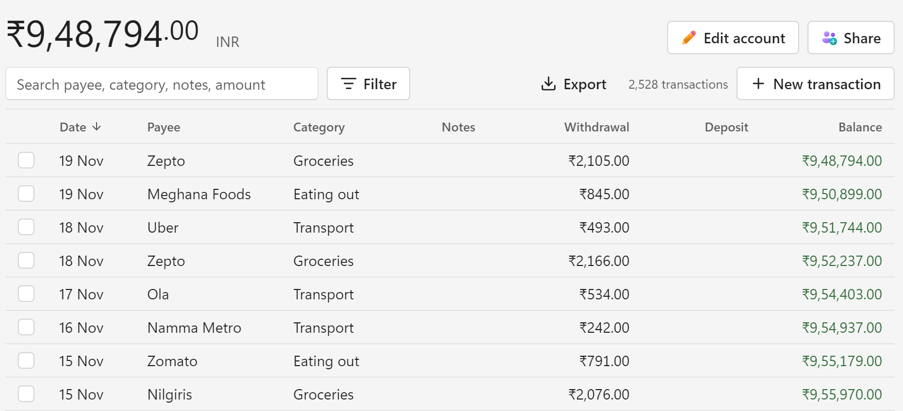
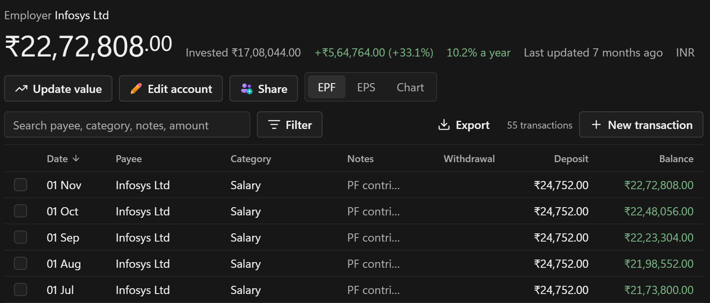
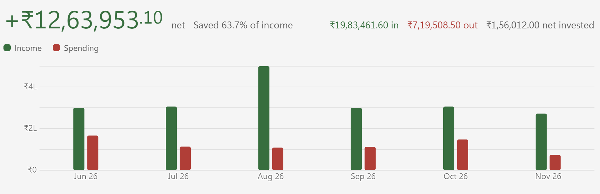

<p align="center">
  
</p>

<h1 align="center">Miserly</h1>

<p align="center">
  <em>miserly (adj., disapproving): hating to spend money.</em> Oxford Learner's Dictionaries<br>
  <strong>Spend what you like. Miserly only wants to know where it went.</strong>
</p>

<p align="center">
  <a href="https://github.com/justanothermedialab/miserly/releases/latest"></a>
  <a href="LICENSE"></a>
  
  <a href="https://github.com/sponsors/varunnjbehera"></a>
</p>

<p align="center">
  <a href="#install-on-windows"><strong>Download for Windows</strong></a>
  &nbsp;|&nbsp;
  <a href="#install-with-docker"><strong>Run with Docker</strong></a>
  &nbsp;|&nbsp;
  <a href="https://miserly.jamlab.in/docs/"><strong>User guide</strong></a>
  &nbsp;|&nbsp;
  <a href="ROADMAP.md"><strong>Roadmap</strong></a>
</p>

An expense and net worth tracker. You enter each transaction yourself, and Miserly adds your bank
accounts, cards, stocks, mutual funds, property and loans into one net worth, in the currency you
choose. PPF, EPF, NPS and lakhs and crores are built in too. No bank logins, and your data stays on
your computer or your own server.

**Status:** preview 26.11.0. It works and has tests, but it's new, so keep a backup of your data file.



## What you can do

- Enter transactions in a register and click any field to change it.
- Move money between your own accounts.
- Track PPF, EPF and EPS, NPS Tier I and II, Sovereign Gold Bonds, fixed and recurring deposits,
  mutual funds, stocks, property and home loans. Anything else goes in as another asset or
  liability.
- See what each investment cost, what it's worth and its return per year.
- Read reports on net worth over time, income and spending, and spending by category or payee.
  Each report has a table and a CSV export.
- Show amounts in lakhs and crores, or in thousands and millions.
- Keep accounts in other currencies, converted at rates you set.
- Share one server with family. Each person's accounts stay private unless they share them.
- Import your data from Actual Budget.



## What it doesn't do

- **No bank sync.** Miserly never reads your bank, SMS, email or statements.
- **No automatic prices.** An investment is worth the value you last entered.
- **No budgeting.** No envelope budgets, rules, scheduled or split transactions, or reconciling.
- **No phone layout** yet.
- **Your main currency is fixed** once you set it up, for now.



## Install on Windows

<a href="https://apps.microsoft.com/detail/9NV8FTQ2SBX3"></a>

**From the Microsoft Store:** click **Get**, then open Miserly from the Start menu. The Store
keeps it up to date. Your data is one file in **Miserly data** in your user folder, for example
`C:\Users\Asha\Miserly data\miserly.db`, and uninstalling leaves it there.

**Or the portable zip,** with no install:

1. Download `Miserly-preview-26.11.0-portable.zip` from
   [Releases](https://github.com/justanothermedialab/miserly/releases).
2. Unzip it and open `Miserly.exe`.
3. If Windows says "Windows protected your PC", click **More info**, then **Run anyway**. This
   happens because the zip isn't code signed yet.

Your data is one file in the `data` folder next to `Miserly.exe`. Both work offline.

## Install with Docker

There are two ways. Both use the published image, `ghcr.io/justanothermedialab/miserly`.

### Quick start: one command

1. Start Miserly:

   ```sh
   docker run -d --name miserly -p 3000:3000 -v miserly-data:/data      -e ORIGIN=http://localhost:3000 ghcr.io/justanothermedialab/miserly
   ```

   Set `ORIGIN` to the exact address you'll open in your browser. `localhost` and `127.0.0.1`
   count as different addresses.

2. Find the setup code in the log:

   ```sh
   docker logs miserly
   ```

   Every start prints a new code, so use the latest one.

3. Open `http://localhost:3000`, enter the code and create your login.

With Podman, use the same commands with `podman` in place of `docker`.

### Keep it running: Docker Compose

1. Download the compose file into a new folder:

   ```sh
   mkdir miserly && cd miserly
   curl -O https://raw.githubusercontent.com/justanothermedialab/miserly/main/src/docker-compose.yml
   ```

2. Start Miserly:

   ```sh
   docker compose up -d
   ```

   It starts again by itself after the machine restarts.

3. Find the setup code with `docker compose logs miserly`, then open `http://localhost:3000` as
   in the quick start.

The compose file opens Miserly on this machine only. To reach it from your other devices, follow
the comments at the top of the file: put it behind a proxy with HTTPS (there's a ready example in
`src/Caddyfile.example`), or, on a home network you trust, open the port to the network.

### Either way

- Your data is kept in the `miserly-data` volume.
- To keep the data in a folder instead, use `./data:/data` in place of `miserly-data:/data`. On
  Linux, give the folder to user 1000 first: `sudo chown 1000:1000 data`. With rootless Podman,
  add `:U` instead: `./data:/data:U`.

**Tested on:** Docker Desktop on Windows (WSL 2), and Podman 4.9 on RHEL 8.10 (root and
rootless). Not yet tested: the ARM64 image (Apple silicon, Raspberry Pi), and Docker on Linux or
a Mac.

The full guide is at [miserly.jamlab.in/docs](https://miserly.jamlab.in/docs/).

## Moving from Actual Budget

1. In Actual, go to **Settings**, then **Export data**.
2. In Miserly, go to **Settings**, then **Import**, and choose the file. On a new install you can
   also click **Import from Actual** on the dashboard.
3. In the preview, set what each account is (an EPF's EPS too) and what each category group
   counts as.
4. Confirm the import.

Accounts, transactions, categories, payees and transfers come across. Budgets, rules and
schedules don't, because Miserly doesn't have them.

You can undo the last import in Settings. If you import a newer export later, only the new
transactions are added.

## How it was built

Miserly was built with AI assistance:

- We wrote the specification first: who it's for, what it does, and 29 user stories with
  acceptance criteria. AI helped draft and research them. The decisions are ours. It's in
  `docs/`.
- AI wrote most of the code and tests from that specification.
- We tested the app ourselves, against the specification and against Actual Budget.
- AI also checked the money calculations line by line with worked examples. Every figure it
  questioned got a test, and the wrong ones were fixed.

A few rules from the specification keep the numbers consistent:

- Balances are always calculated from transactions, never stored separately.
- A transfer is two linked transactions, so it never changes your net worth.
- Amounts are stored in whole paise.
- Every account type reports its value, cost and cash flows the same way, so net worth has no
  special cases.

This repository starts with a single commit. Development happened in a private repository with
working notes and personal test data. From here on, changes land here one at a time.

## Built with

SvelteKit and Svelte 5, TypeScript, SQLite, Tailwind and LayerChart, with Electron for the
Windows app. The money engine is plain TypeScript, with no framework or database code in it.

## Contributing

Bug reports and ideas are welcome in [Issues](https://github.com/justanothermedialab/miserly/issues),
and we read all of them. We can't accept code contributions yet, because the licensing for them
isn't set up.

## Support

Miserly is free. Sponsorships pay for:

- AI tools to write and check the code, paid monthly
- Code signing, so Windows and macOS open Miserly without a warning
- Test machines: an Apple silicon Mac, ARM64 machines, an Android phone, a second monitor and a
  development machine with more memory

[ROADMAP.md](ROADMAP.md) lists what each level of monthly sponsorship pays for.

To sponsor, use the **Sponsor** button at the top of this page. The money goes to the developer's
own GitHub account. The app never asks you for it.

## Licence

AGPL-3.0. © 2026 JAM Lab. Third-party notices are in `THIRD-PARTY-NOTICES.txt`.
