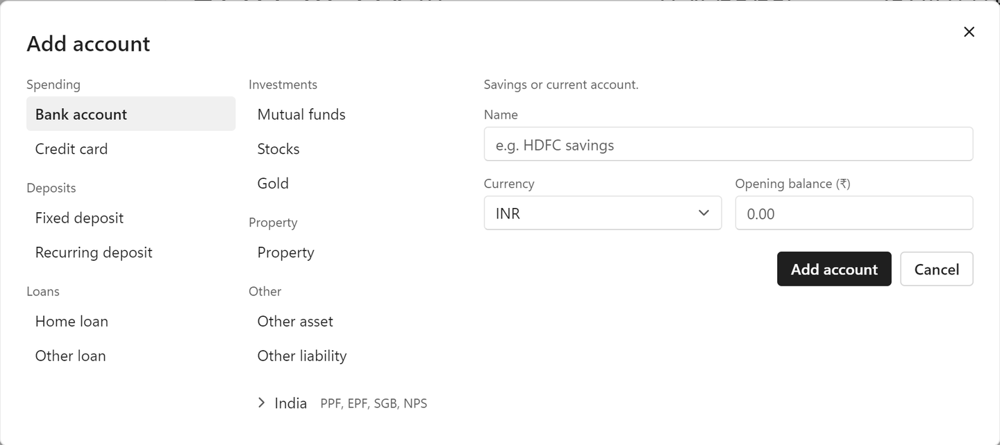
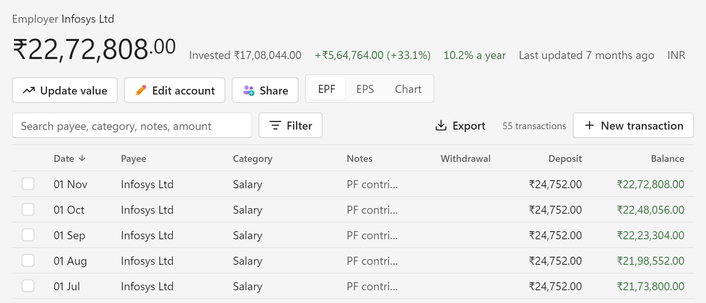
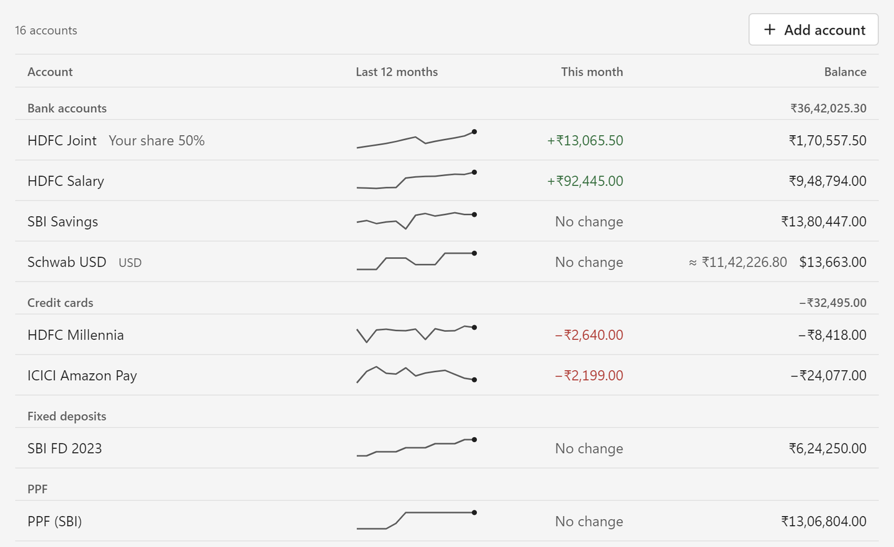

An account is anything that holds money or owes it: a savings account, a credit card, a fixed
deposit, a mutual fund, a PPF, a home loan.

## Adding an account

Click the **+** next to **Accounts** in the left-hand list (or **Add account** on the All
accounts page). Pick what you're tracking on the left, then fill in the form on the right.

| Group | Types |
| --- | --- |
| Spending | Bank account, Credit card |
| Deposits | Fixed deposit, Recurring deposit |
| Loans | Home loan, Other loan (car, personal, education, gold) |
| Investments | Mutual funds, Stocks, Gold (ETF, digital, physical) |
| Property | Property |
| Other | Other asset, Other liability |
| India | PPF, EPF, Sovereign Gold Bond, NPS Tier I, NPS Tier II |

The India group is folded at the bottom of the right-hand column; click it to open it.

Anything without a type of its own goes in as an **Other asset** (or an **Other liability** if
you owe it): crypto, ESOPs, bonds, a Sukanya or Post Office scheme, NSC. Insurance counts only
if it has a value you could cash in: a ULIP at its fund value, an endowment or LIC policy at its
surrender value. Term, health and motor premiums are spending, not an asset.

The form:

- Name: whatever you call it, such as "HDFC savings" or "Parag Parikh Flexi Cap".
- Currency: your totals' currency unless you change it. PPF, EPF, SGB and NPS are always in
  rupees. See [Settings](settings.md) for other currencies.
- The amount: what's in it today (a bank account's opening balance), what you owe (a card or
  loan), or what you've put in so far (a fund, deposit or scheme). The label says which.
  Investments also have an optional Current value: type it if you know it.
- As of: appears once you type an amount. It's the date that amount is true on, and starts on
  today.
- Details: for some types, things like a card's limit, a deposit's rate and maturity date, a
  loan's kind, or a fund's folio number. They're mostly for your reference; PPF's and SGB's dates
  also work out the dates shown on their pages, as below.

Click **Add account**. Its page opens, ready for the first transaction.

## The Indian schemes

### PPF

Type what you've deposited so far and, under details, the date it was **Opened on**. The
account's page then shows when it **Matures** (1 April, 15 years after the end of the financial
year it opened in) and how much you've **Deposited this year** against the ₹1.5 lakh limit, from
1 April. Deposits are transfers from your bank account. When you get your passbook or check the
balance online, click **Update value** and type it: the difference is the interest.

### EPF and its EPS

An EPF comes with its EPS (the pension part) as a second tab, made in the same step: type what
the EPFO passbook shows as paid in so far and, if you want, the pension column's total in **EPS
paid in so far**. The EPS is named "EPS of" and the EPF's name, and the EPF's page has three tabs:
**EPF**, **EPS** and **Chart**.

Each month's contribution is a deposit on the EPF under the category Salary: it's part of your
pay, so it counts as income and as money put in. When the passbook shows interest, click
**Update value** on the EPF. The EPS has no value to update: EPFO shows no balance for it, so it
counts at what was paid in and earns nothing here. Add one EPF for each employer if you like.

### Sovereign Gold Bond

Type what you paid, and under details the grams, issue date and prices. The page shows when it
**Matures** (8 years after issue) and from when it can be cashed early (5 years after issue). The 2.5 %
interest is paid into your bank account: add it there, not on the bond. Update the bond's
value from the gold price when you check it.

### NPS

Tier I (the pension account, locked in) and Tier II (the savings account you can withdraw from)
are separate accounts in one NPS section. Add Tier II only if you have one. Your own
contributions are transfers from your bank; your employer's, paid straight in, are deposits
under Salary. Type the value from your CRA statement with **Update value**. Miserly works out
nothing for NPS (no exit age, annuity or tax): the rules differ by sector and changed in 2025.

## Finding your accounts

The left-hand list shows every account under its section (Bank accounts, Credit cards, Mutual
funds, PPF and so on) with its balance. Click a section name to see that section's accounts
together, or **All accounts** for everything.

## Changing or closing an account

Open the account and click **Edit account** to rename it, change its details or close it.

**Close account** keeps its history but takes it out of your totals and lists. On All accounts,
**Show closed** lists closed accounts; open one and reopen it from **Edit account**. If the
account still holds money, Miserly asks where it went: pick the account and click **Move and
close**, or write it off as a loss. If it still owes money, pick the account that paid it
(**Pay and close**) or close it with an adjustment to zero.
