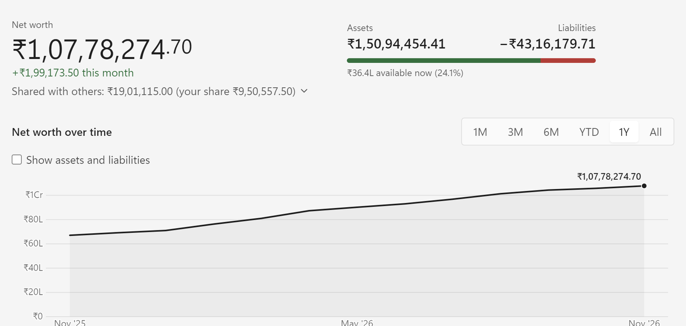
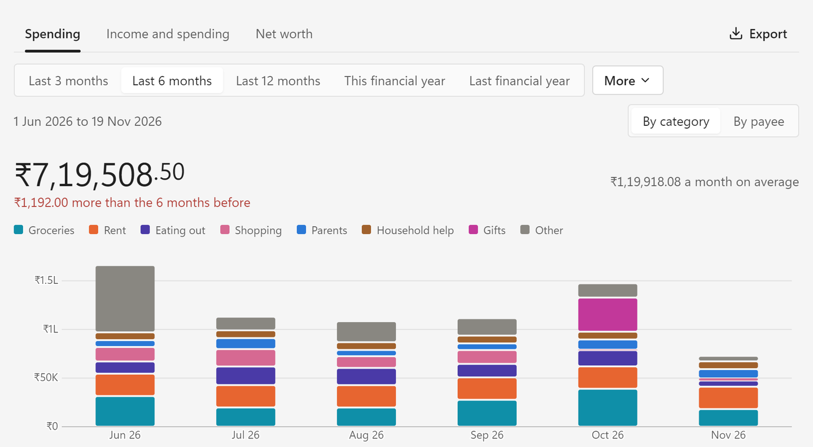

## Dashboard

The dashboard is the first page you see.

- Net worth: everything you own minus everything you owe, as of today. Beside it, your assets
  and liabilities.
- Net worth over time: how that total has moved. Pick a range at the top right of the chart
  (1M to All). **Show assets and liabilities** draws them as two more lines. The chart starts
  once you have a full month of data.
- Recent activity: your latest transactions. **View all** opens All transactions.
- Spending this month: what you've spent so far, against last month by the same day.
- Allocation: how your assets split **By class** (bank, funds, PPF, gold and so on) or **By
  availability** (Available now, Available soon, Locked in). Click a slice or its name to see
  the accounts in it.

Point at any chart to see the figures for that day or month. Future-dated transactions don't
count in today's figures.

## Reports

**Reports** in the left-hand list has three views: **Spending**, **Income and spending** and
**Net worth**. Pick a period at the top: Last 3, 6 or 12 months, or this or last financial
year (This year and Last year if your year starts in January). **More** has the rest,
including This month, Last month, All time and **Custom range** for any two dates.

- Spending: spending by month, split by category, and a table of each category by month with
  its average, share and total. **By payee** shows the same spending by payee instead. Click a
  bar or a figure in the table to list the transactions behind it.
- Income and spending: money in against money out, month by month, with a table below. Saved
  is the share of income you didn't spend. If you moved money into investments in the period,
  Net invested shows how much.
- Net worth: your net worth by class over time, with a table of each class's value and the
  change.

Transfers between your own accounts without a category, and value updates, never count as
spending or income. A transfer with a category counts by that category: one under a category
in the Investments group (Investments, SIP, say) counts in Net invested, not in spending.
