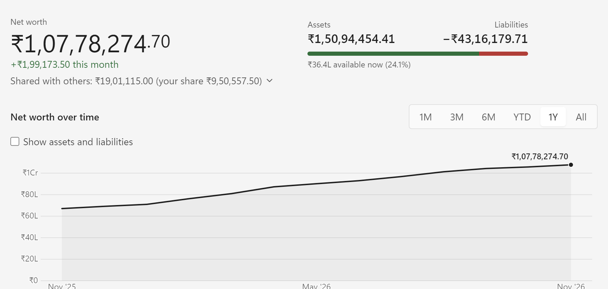

Miserly tracks what you spend and what you own. You enter your transactions and accounts, and
it adds them into one net worth, shows where your money went and keeps track of what your
investments are worth.

It runs on your own computer, or on a home server you open in a browser. Nothing you enter is
sent anywhere: no bank logins, no SMS or email reading, and no online account to sign up for.

This is a preview. You can use it every day, but expect rough edges.
[Preview notes](preview-notes.md) lists what isn't in it yet and how to report a problem.

## Start here

- **New to Miserly?** Read the [Quick start](quick-start.md).
- **Using Actual Budget now?** Read [Coming from Actual](switching-from-actual.md).
- **Running it on a home server?** Read [Install](install.md#docker).

## Every page

| Page | What's in it |
|---|---|
| [Quick start](quick-start.md) | From unzipping to your first transaction |
| [Install](install.md) | The Windows app, Docker, and updating later |
| [Coming from Actual](switching-from-actual.md) | Importing your Actual Budget history, step by step |
| [Accounts](accounts.md) | Bank accounts, cards, deposits, loans, funds, PPF, EPF, NPS, property |
| [Transactions](transactions.md) | Adding, editing, transfers and the To categorize list |
| [Investments](investments.md) | Putting money in and updating what it's worth |
| [Dashboard and reports](dashboard-and-reports.md) | Reading your net worth and spending |
| [People and sharing](people-and-sharing.md) | Other logins, and sharing an account |
| [Settings](settings.md) | Theme, number format and other currencies |
| [Your data](your-data.md) | Where it's kept and how to back it up |
| [Preview notes](preview-notes.md) | What's missing, and reporting a problem |
