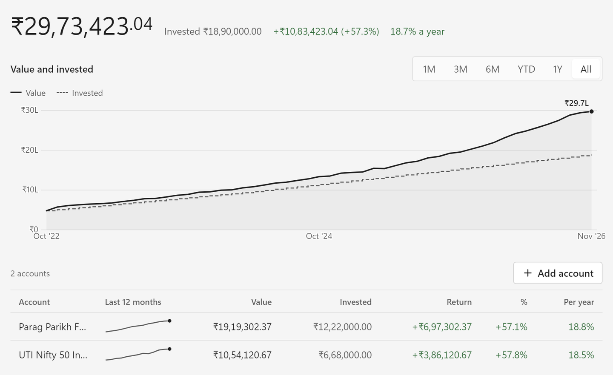
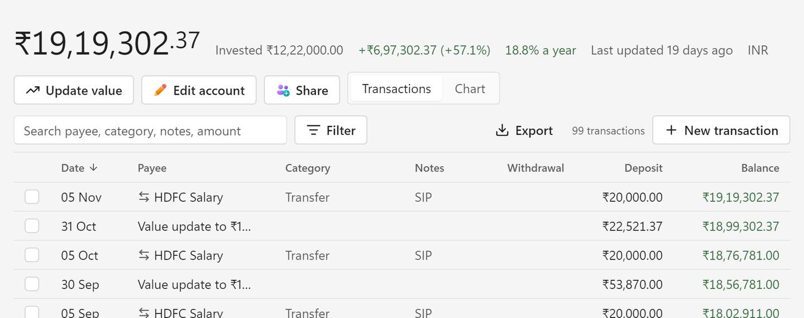

Mutual funds, stocks, gold, deposits, PPF, EPF, NPS, property and Other asset accounts show two
things: what you've put in, and what it's worth now.

## Putting money in

A SIP or a lump sum is a transfer from your bank account to the fund. Add a transaction on the
bank account with **Transfer →** and the fund as the payee (see
[Transactions](transactions.md#transfers)). The fund's Invested figure goes up by that amount.
Taking money out works the same way in reverse.

An EPF's or NPS's employer contributions arrive without a transfer: add them on the account
itself, as a deposit under Salary (see [Accounts](accounts.md#epf-and-its-eps)).

## Updating what it's worth

Miserly doesn't fetch prices. When you check a fund's value (in your fund app, a statement or
the AMC's site):

1. Open the fund in Miserly and click **Update value**.
2. Type the **New value** and its date.
3. Click **Save value**.

- The difference is recorded as a value update, not as income or spending. It changes your net
  worth but stays out of your spending reports.
- Update as often as you like: weekly, monthly or whenever you remember. **Last updated** at the
  top says how long ago it was, and turns amber once it's been a while.

**Adding a missed deposit later.** A value update sets the value as of the end of its date. A
deposit you add on that same date afterwards is added on top. So date the missed deposit before
the update, or enter the update again after it.

## Reading the numbers

At the top of a fund's page:

- The big figure: its value. That's the last value you typed, plus anything you've put in
  since.
- Invested: everything you've put in, minus what you've taken out.
- The gain: value minus invested, and that as a percentage of invested.
- A yearly figure, such as "12.4 % a year": the return per year since you started tracking it,
  counting when each amount went in. Point at it to see the start date. It shows once the
  account has a year of history and at least one value update.

Each value you type shows in the list as **Value update to ₹…**, so you can see how it moved.
**Chart** at the top shows the value against what you put in, over time.

The percentage gain is the total since you started, not a yearly figure. To compare a fund with
a deposit's interest rate, use the yearly figure.

## Costs and charges on an investment

A charge typed on the investment itself (a demat fee, say) under a spending category counts as
money taken out and spent: Invested goes down by it, the return doesn't change, and the charge
shows in your spending. If you'd rather it lowered the return, open its category in **Categories**
(left-hand list) and turn on **Counts as return (gain or loss)**.
