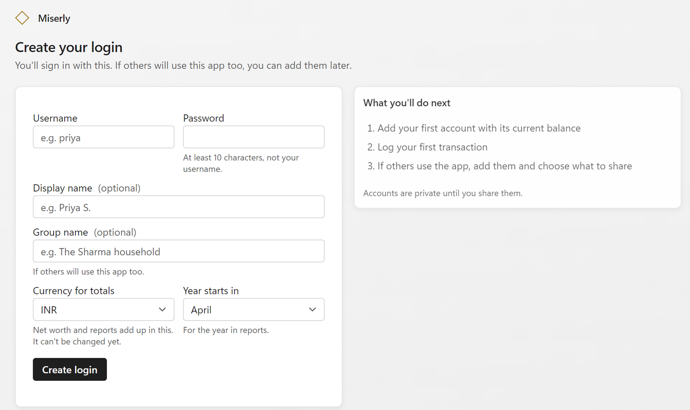

From opening Miserly to your first transaction, on Windows. For Docker, start with
[Install](install.md#docker) and come back at step 2.

## 1. Open Miserly

From the [Microsoft Store](https://apps.microsoft.com/detail/9NV8FTQ2SBX3): click **Get**, then
open **Miserly** from the Start menu.

Or from the portable zip:

1. Right-click **Miserly-preview-26.11.0-portable.zip** and choose **Extract All**.
2. Open the extracted **Miserly** folder and double-click **Miserly.exe**.
3. If Windows says **Windows protected your PC**, click **More info**, then **Run anyway**.

## 2. Create your login

| Field | What to type |
|---|---|
| Username and Password | What you'll sign in with. The password needs 10 characters or more. |
| Display name | Optional. What the app calls you. |
| Group name | Optional. Only matters if other people will use this copy of Miserly. |
| Currency for totals | The currency your net worth and reports add up in. It starts on INR. |
| Year starts in | January or April, for the year choices in Reports. April is picked for rupees. |

Check the last two carefully: neither can be changed later in this version.

Write the password down somewhere safe. There's no "forgot password" email, because nothing
leaves your computer.

On Docker there's one more field first, **Setup code**. See
[Install](install.md#the-setup-code).

Click **Create login**.

## 3. Add your accounts

The dashboard opens empty, with two ways in:

- **Add account**: pick **Bank account**, type its name and today's balance, and click **Add
  account**. You don't need old history: start from today's balance.
- **Import from Actual**: if you use Actual Budget. See
  [Coming from Actual](switching-from-actual.md).

Then add the rest the same way: credit cards (what you owe today), deposits, funds, PPF, EPF,
gold and loans. For an investment, type what you've put in so far and, if you know it, what
it's worth now. See [Accounts](accounts.md).

## 4. Add a transaction

1. Click **Add** at the top right. It works from any page.
2. Pick the account, then fill in the payee, a category and the amount: **Withdrawal** for
   money out, **Deposit** for money in.
3. Click **Save**.

## 5. Look at the totals

- **Dashboard**: your net worth and this month's spending.
- **Reports**: spending by category, income against spending, and net worth over time.

## From then on

- Add transactions as they happen.
- When you check an investment's value, update it in Miserly. See
  [Investments](investments.md#updating-what-its-worth).
- Back up now and then: close Miserly and copy `miserly.db` from the **data** folder next to
  **Miserly.exe** somewhere safe. See [Your data](your-data.md).
