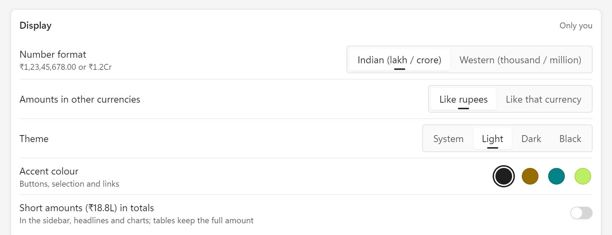

Open **Settings** from the **⋯** button (Settings and more) at the top right.

## Display

These are yours only; other people on the same Miserly keep their own.

- Number format: Indian (lakh, crore) or Western (thousand, million).
- Amounts in other currencies: written like your totals' currency, or the way that currency is
  usually written.
- Theme: System (follows your computer's light or dark setting), Light, Dark or Black.
- Accent colour: the colour of buttons, selection and links (Ink, Gold, Teal, Lime, and
  on the Windows app your Windows accent colour).
- Short amounts in totals: shows totals such as ₹12.4 L in the left-hand list, headlines and
  charts. Tables keep the full amount.

## Group

The group's name, shown under your name in the left-hand list. Leave it blank for none. The
admin also manages **Members** here: see [People and sharing](people-and-sharing.md).

## Currencies

Totals are in the currency you chose at setup; it can't be changed in this version, nor can the
month your year starts in. Both are shown here.

You can still keep an account in dollars, euros or another currency: pick the currency when you
add it. Miserly converts it for your totals using a rate you set here, under **Rates set by
hand**: click **Set rate** beside the currency. Until it has one, the account shows **Rate
needed** and stays out of your totals. Click **Edit** to change the rate whenever you like.
Only someone who holds an account in a currency can set its rate.

## Import

Brings in Actual Budget's export, and lists past imports with **Undo import**. See
[Coming from Actual](switching-from-actual.md).

## Your data

On the Windows app: where your data file is, with **Copy path** and **Open folder**. See
[Your data](your-data.md).

## Zoom and shortcuts

The **⋯** menu also has zoom controls (on the Windows app), **Keyboard shortcuts** and **About
Miserly**, which shows your version.
