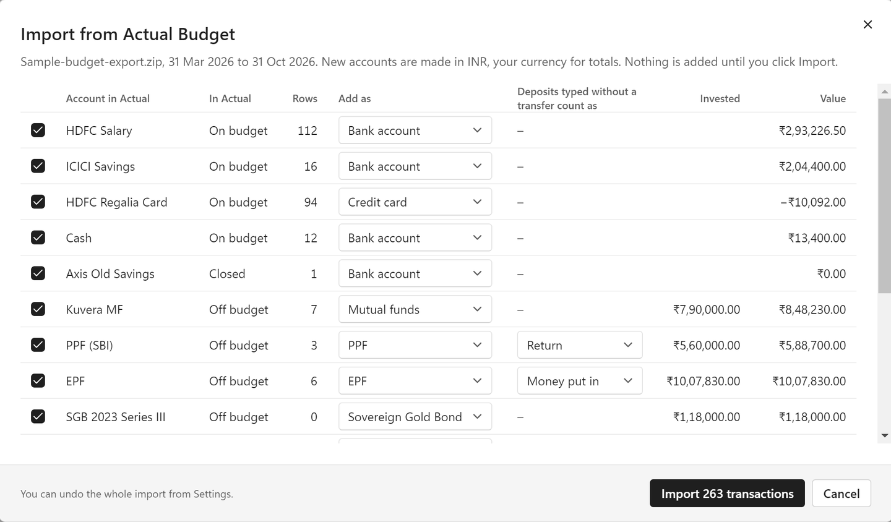

If you track your money in Actual Budget, Miserly can bring your accounts and their whole
history across. You see everything before it's saved, and the whole import can be undone.

## Switch in four steps

Pick one day to switch, and type each transaction in one app only.

1. In Actual, catch up: enter everything up to today.
2. In Actual, go to **Settings**, then **Export data**. Actual saves a zip. Leave it zipped.
3. Import that zip into Miserly (below), then check each account's balance against Actual's.
   They should match to the paisa.
4. From the next day, enter new transactions in Miserly only.

## Import the file

1. In Miserly, click **⋯** at the top right, then **Settings**.
2. In the **Import** card, click **From Actual Budget**, then **Choose file**, and pick the zip.
   On a new, empty Miserly you can click **Import from Actual** on the dashboard instead.
3. The preview opens. Check it (see the next section).
4. Click **Import**. The button says how many transactions it will add.

The new accounts appear in the left-hand list straight away. They're yours and private, like
any account you add.

Miserly refuses a file that isn't Actual's export, a zip over 60 MB, or an export from a
version of Actual it can't read. It says which, and nothing is saved.

## The preview

Nothing is saved until you click **Import**. Each Actual account is one row:

| Column | What it shows | What to do |
|---|---|---|
| Tick | Whether the account comes in | Untick an account to leave it out |
| Account in Actual | Its name | If the name turns red, you already have an account by that name: rename this one in the box |
| In Actual | On budget, off budget or closed | Nothing |
| Rows | How many transactions it has | Nothing |
| Add as | What it becomes in Miserly | **Check every one.** Miserly guesses from the name |
| Deposits typed without a transfer count as | For investments only: **Return** (growth) or **Money put in** (counts toward Invested) | EPF, EPS and NPS start on Money put in, the rest on Return. Change it if that's wrong for an account |
| Invested and Value | What the account will show once imported | Nothing |

Notes that can appear on a row:

| Note | Meaning |
|---|---|
| Already here | You imported this account before. Only its new rows come in |
| Comes in open | It's closed in Actual, but still has money or rows after today |
| Starts after today | Its first row is in the future, so it can't be imported |

**An EPF's pension.** If you kept the EPS as its own account in Actual, set **Add as** to "EPS
of" that EPF.

**Category groups used for investing.** If Actual used a group (a "SIPs" group, say) on
transfers into your investments, the preview asks how to count it:

- **Investments** keeps those transfers out of your spending and counts them in Reports' Net
  invested. A group used only that way starts on this.
- **Spending, as in Actual** keeps them as spending.

At the bottom, **What comes in** and **What is left out** count everything before you commit.

## What comes across

- Every account you tick, at Actual's balance.
- Every transaction, with its date, payee, category, notes and amount.
- Transfers between your accounts, still linked as transfers.
- Split transactions, as separate rows: one per part, same date and payee.
- Your categories and groups. A category name you already have is reused, not doubled. Hidden
  categories stay hidden.
- On an investment, Actual's reconciliation adjustments, as value updates on their dates.

A closed Actual account comes in closed if it's at zero with nothing after today. Transfers to
accounts you left out come in as one row each, under **Transfer to Self**, a category reports
leave out.

## What doesn't

- Budgets, rules and schedules. Miserly has none of these.
- Cleared and reconciled marks, and deleted rows.
- The Starting Balances category. Each account's first starting balance becomes its opening
  balance instead.
- A currency. Actual's file doesn't record one, so everything comes in the currency you chose
  at setup.
- If Actual is set to another language, its reconciliation adjustments come in as ordinary
  rows.

## After the import

- **Update each investment's value.** Open it and click **Update value** with today's value.
  Actual can't show what an investment is worth now; Miserly can.
- **Look at To categorize** in the left-hand list. Actual can't categorise rows on off-budget
  accounts, so some will be waiting there.

## Running both apps for a while

You can keep using Actual and import a newer export later. Miserly recognises rows it already
has and adds only the new ones. Two things to watch:

- A row you change in Actual after importing isn't updated in Miserly. Change it in Miserly too.
- A row you type in both apps comes in twice. Type new rows in Actual only until your last
  import, then in Miserly only.

## Undo an import

1. Go to **Settings**, **Import**. It lists each import with its date, file and counts.
2. Click **Undo import** on the latest one and confirm.

It removes the accounts that import added, with all their rows (including any you've typed
since; it tells you how many), and the categories and payees nothing else uses. Only the latest
import can be undone. If you've shared one of its accounts, stop sharing it first.
