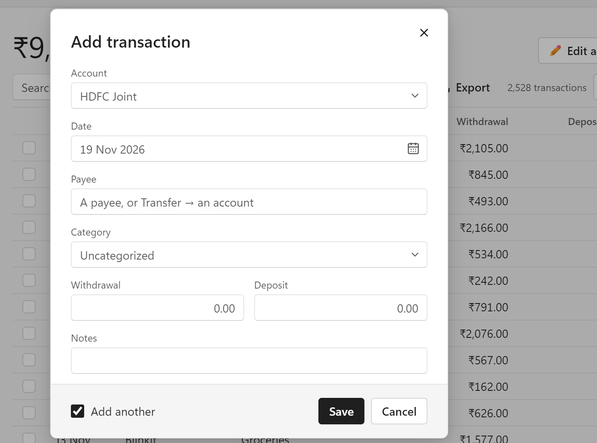
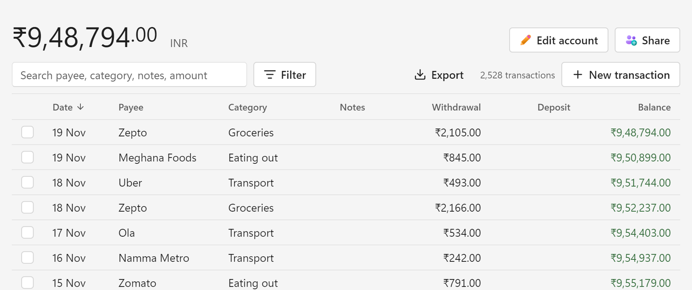
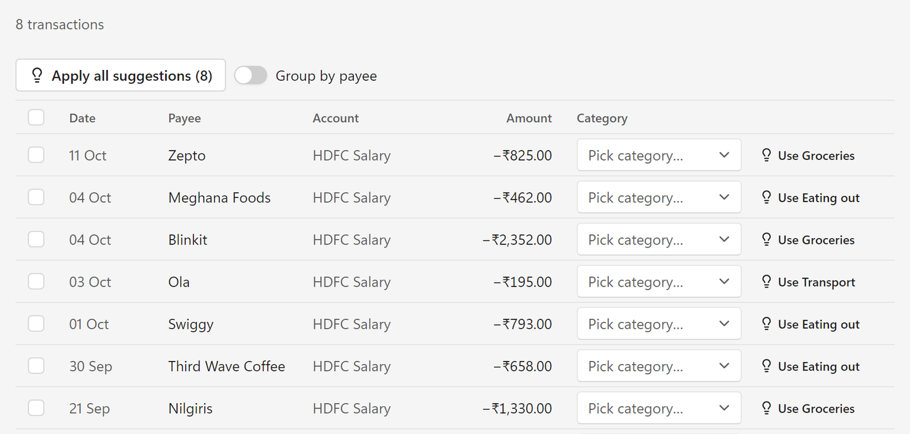

Every amount in or out is a transaction: a date, a payee, a category and an amount.

## Adding one

You can add a transaction from two places.

From anywhere: click **Add** at the top right of the window (or press **Ctrl+Shift+N**). Pick
the account, fill in the rest and click **Save**.

With **Add another** ticked, the form stays open for the next one.

On an account's page: click **New transaction**. A new row opens in the list; type into it and
press **Enter** to save. A fresh row opens for the next one.

- Payee: who you paid or who paid you. Start typing and pick from the list, or type a new name.
  Miserly remembers each payee's usual category and fills it in next time.
- Category: Groceries, Rent, Salary and so on. Leave it as Uncategorized if you're not sure;
  the transaction goes to **To categorize** for later.
- Withdrawal or Deposit: money out or money in. On a credit card or a loan they're called
  Charge and Payment.
- Notes: anything you want to remember.

## Editing

Click any part of a row to change it in place: the date, payee, category, notes or amount.
Right-click a row for **Duplicate**, **Move up**, **Move down** (within its day) and **Delete**.
A delete can be undone from the message that appears.

Back-dating is fine: enter a transaction with last week's date and the balances after it
update.

## Transfers

Moving money between your own accounts (paying a card bill, a SIP into a fund, an FD from
savings) is a transfer, not spending. In the payee field, pick **Transfer →** and the other
account. Miserly records it on both accounts and leaves your net worth unchanged.

A transfer between two of your bank accounts or cards has no category. A transfer from a bank
account or card into an investment can take one, such as Investments, SIP: pick it the first
time, and Miserly fills it in for the next transfer into that investment. A category in the
Investments group keeps the transfer out of your spending and counts it in Reports' Net
invested; a spending category counts it as spending.

If the two accounts are in different currencies, it asks for the amount received too.

## To categorize

**To categorize** in the left-hand list shows every transaction without a category. Pick a
category on each, or tick several, choose a category and click **Categorize** to set them
together. Where Miserly can guess from the payee's past entries, the row offers **Use** and the
category; **Apply all suggestions** takes every guess at once.

## Finding transactions

Each account's page has a search box (payee, category, notes or amount) and a **Filter** button
for type, category and dates. **All transactions** has the search box. On both, **Export** saves
the rows you're looking at as a CSV file you can open in Excel or Google Sheets.
